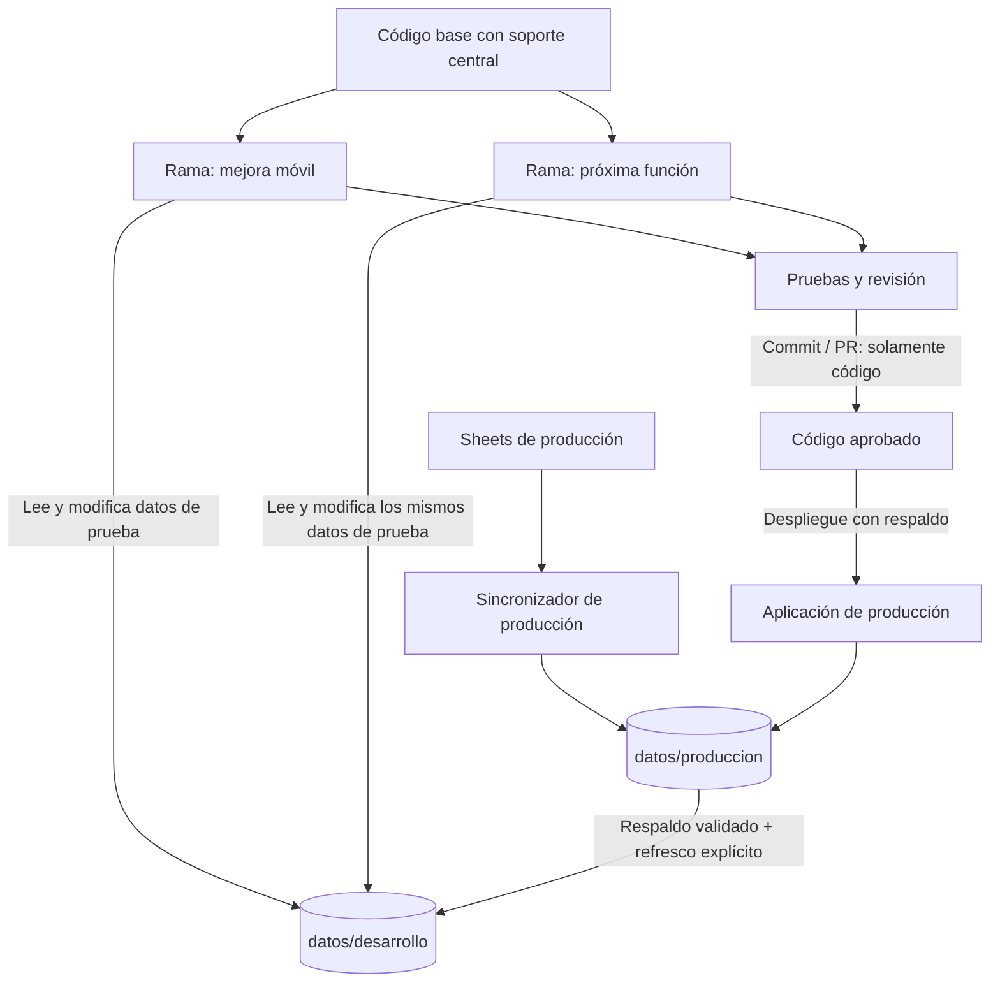
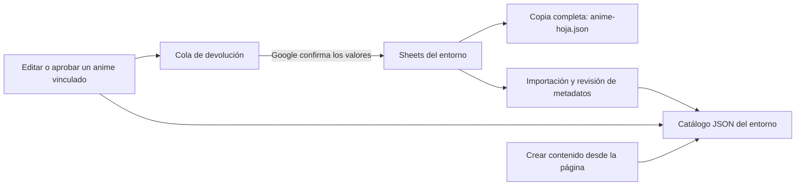

# Catálogo independiente de las ramas

Implementado el 2026-10-09. El código sigue en Git; los datos operativos están fuera de ambos repositorios.

| Entorno | Catálogo activo | Estado de sincronización |
| --- | --- | --- |
| Producción | `Altoids/datos/produccion/catalogo` | `Altoids/datos/produccion/anime-sync` |
| Desarrollo | `Altoids/datos/desarrollo/catalogo` | `Altoids/datos/desarrollo/anime-sync` |

El descriptor externo `ProyectoFinal/catalog-storage.local.json` o `Desarrollo/catalog-storage.local.json` selecciona el entorno. No contiene credenciales. `ALTOIDSS_STORAGE_CONFIG` permite señalar el mismo descriptor desde un nuevo worktree. API, sincronizador y rutas JSON públicas usan ese catálogo; el router no sirve archivos privados. Las utilidades masivas antiguas pueden consultar datos, pero rechazan escrituras centrales porque omiten revisión/cola: `import_anime_excel.py`, `apply_anime_review.py`, `sync_anime_workbook.py --apply` y `enrich_anime_metadata.py` sin `--dry-run`. Para modificar el catálogo operativo usa el administrador y `anime_sync_pipeline.py`.

Las antiguas copias `Aplication/data/*.json` permanecen como archivos de referencia versionados, pero no son el catálogo activo cuando existe el descriptor. No recuperarlas con Git como forma de actualizar datos. No usar junctions: un checkout podría escribir dentro del destino central.

`anime-hoja.json` guarda todas las filas de origen A:J, valores literales y número de fila. `anime.json` contiene todos sus códigos, además de los registros locales y los metadatos enriquecidos. Cada registro vinculado guarda `sheetValues` y `sheetSource`. Las discrepancias con metadatos aprobados no se resuelven sobrescribiendo silenciosamente la aprobación. Registros sin comprobación externa quedan marcados para revisión, pero no desaparecen del catálogo ni de la copia de la hoja.

El sincronizador no puede devolver `unchanged` si falta un código de la hoja en el catálogo. Si las APIs están indisponibles conserva el registro de origen con `metadataVerified: false` y revisión pendiente. Las altas desde la página siguen sin crear filas en Sheets.

## Ramas y worktrees nuevos

La rama debe incluir `catalog-storage.php`, `catalog_storage.py` y sus consumidores. Primero integra este cambio de código; no copies JSON antiguos. Cambiar a una rama anterior que no incluye este soporte no la vuelve compatible automáticamente.

El launcher versionado en este repositorio permite abrir un checkout de pruebas:

```powershell
.\tools\start-central.ps1 -Environment desarrollo -Workspace 'C:\ruta\Altoids' -AppPath 'C:\ruta\del\worktree' -Port 8093
```

Todas las ramas de desarrollo arrancadas así usan el mismo catálogo de desarrollo: una edición de prueba será visible en las demás. No ejecutes múltiples sincronizadores sobre el mismo entorno; el bloqueo de entorno rechaza el segundo proceso. El launcher rechaza código sin soporte central y prohíbe apuntar un worktree de pruebas a producción. Para el checkout habitual basta `.\tools\start-central.ps1`; si el puerto 8092 está ocupado usa otro puerto o el servidor que ya está abierto. PHP/Python deben estar en PATH o especificarse con `-PhpBin` y `-PythonBin`. Para celular usa `-BindAddress 0.0.0.0` solo en una LAN de confianza, sin abrirlo a Internet. Configuración Sheets/OAuth propia de cada checkout, fuera de Git. Las credenciales de MAL/Watchmode se configuraron localmente con autorización del usuario; el launcher no las copia.

Los datos de desarrollo se refrescan solo desde una instantánea validada de producción, nunca en sentido inverso. Ese refresco es explícito para no borrar pruebas en curso. No copiar usuarios, OAuth, tokens, colas ni decisiones de revisión entre entornos. Mantener credenciales Sheets separadas.

## Respaldo y reversión

`tools/preproduction-snapshot.ps1` conserva los dos checkouts y los directorios centrales en la misma fase, con hashes. Los respaldos contienen datos privados. Para revertir datos restaura únicamente el directorio central del entorno desde una copia verificada, con el sincronizador detenido; no aplicar el stash completo. Para volver al almacenamiento antiguo hay que desactivar primero el descriptor externo y restaurar el código compatible con su respaldo, nunca dejar código antiguo usando datos antiguos por accidente.

El router PHP es obligatorio para que las rutas estáticas lean el catálogo central. Una futura instalación Apache necesita un enrutamiento equivalente; acceder por `file://` no usa el catálogo central.

## Creación de ramas y separación código/datos



Git no actualiza los datos operativos. Ninguna flecha devuelve datos de desarrollo a producción. Un checkout anterior al soporte central sigue siendo incompatible; incorporar primero el código mediante PR. Para experimentos independientes emplea fixtures/descriptores separados, no otra rama apuntando al mismo catálogo compartido. El refresco producción → desarrollo es explícito y requiere respaldo y escritores detenidos; no ejecutarlo mientras alguien prueba.

## Ediciones, aprobación y redundancia por entorno



La copia literal de la hoja incluye todos los códigos; los metadatos aprobados se conservan por separado y no necesariamente coinciden campo por campo. Los registros locales sin vínculo también permanecen en JSON. JSON → Sheets solo actualiza códigos existentes y únicos, nunca agrega una fila por crear contenido desde la página. La fila se resuelve por código, no por la antigua posición. El estado «Confirmado» requiere respuesta de Google y lectura posterior de los mismos valores; fallos conservan la cola.

## Concurrencia y recuperación

- `.storage.lock` es compartido por PHP/Python y todas las ramas del entorno; no borrarlo para desbloquear. El sistema libera el bloqueo cuando termina el proceso.
- `.watcher.lock` vive en el estado central; solo un monitor/aplicación CLI puede escribir por entorno. Un PID local no basta como exclusión.
- Catálogo, revisiones y cola se preparan bajo un bloqueo corto. `.transaction.json` conserva las colecciones de una operación; antes de leer/escribir se termina una operación interrumpida. No es una transacción de base de datos ni un reemplazo simultáneo de archivos: es recuperación hacia adelante.
- Consultas de Google/proveedores quedan fuera del bloqueo. Si una aprobación cambia los archivos durante la consulta, el sincronizador rechaza su resultado y reintenta en la siguiente ronda; no pisa la aprobación.
- Si la aplicación responde con error tras guardar el diario, la siguiente lectura puede completar la operación. Verifica el catálogo y la cola antes de repetir una alta. Una falla de disco/diario inválido requiere intervención, no borrar el diario.
- Datos personales y catálogo no se mezclan en una transacción. Este cambio protege operaciones de catálogo/aprobación; no promete serialización de todos los flujos privados de usuario.

La revisión actual mantiene Sheets apagado: no usar `-Sync` hasta que el usuario autorice cargar sus cambios nuevos. La migración histórica de desarrollo no se traslada a producción copiando JSON; producción necesita su propia vista previa y autorización.

Ver [avance y punto de reanudación](RELEASE-PROGRESS.md), [verificación de liberación](QA-RELEASE-2026-10-19.md) y [despliegue/reversión](DEPLOYMENT-CENTRAL.md).
